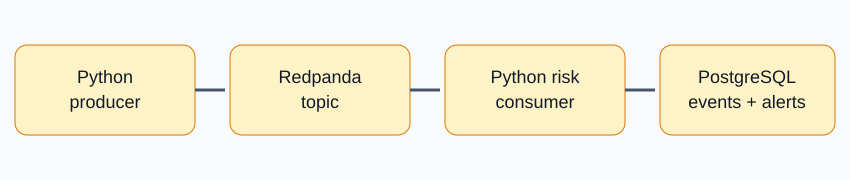

# Mobile Money Transaction Streaming



Synthetic M-Pesa-style events are produced to Redpanda (Kafka protocol), evaluated by a Python consumer and persisted in PostgreSQL. No real customer or payment data is used.

## Run
```bash
docker compose up --build
```
Redpanda Console: http://localhost:8080. PostgreSQL: `localhost:5435`.

## Detection rules
- Transfers at or above KSh 100,000 are flagged.
- Five or more transactions from one sender within 60 seconds are flagged.
- Event IDs are primary keys, so duplicate writes are ignored.

This is a demonstration rules engine, not a production fraud model. It does not block payments or make decisions about real people.

## Design decisions
Redpanda is Kafka-compatible and convenient for local development. JSON events are easy to inspect. PostgreSQL stores raw events and alerts. A production system would add durable offset management, schema registry, event-time windows, replay tooling, dead-letter queues and model validation.
